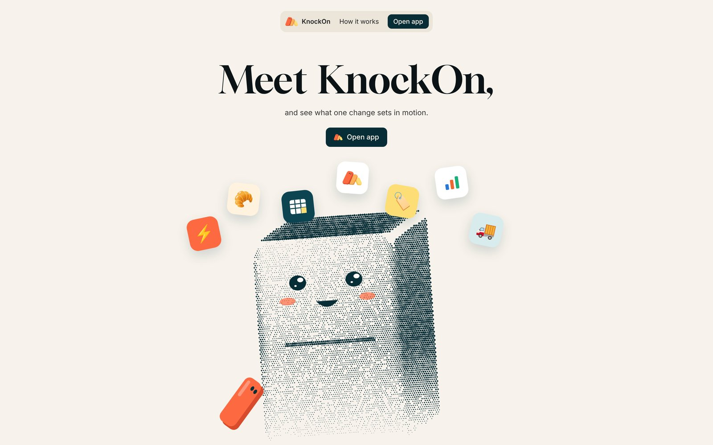
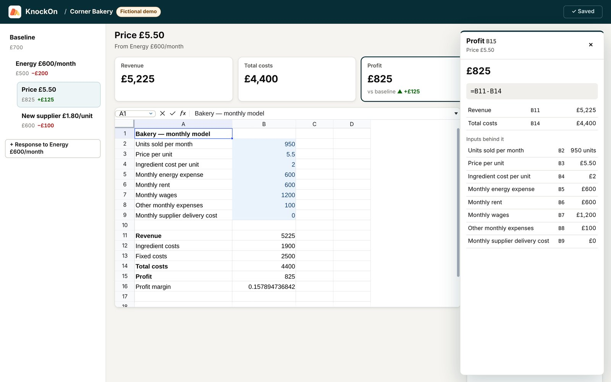
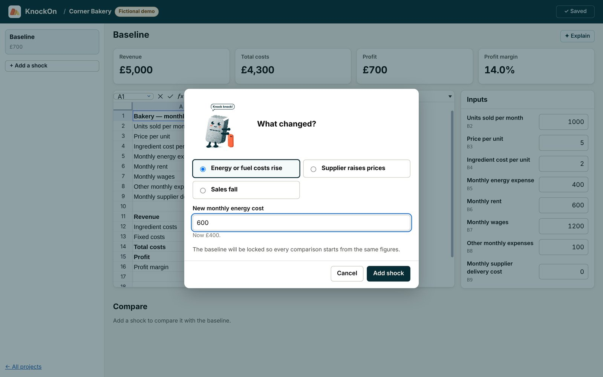
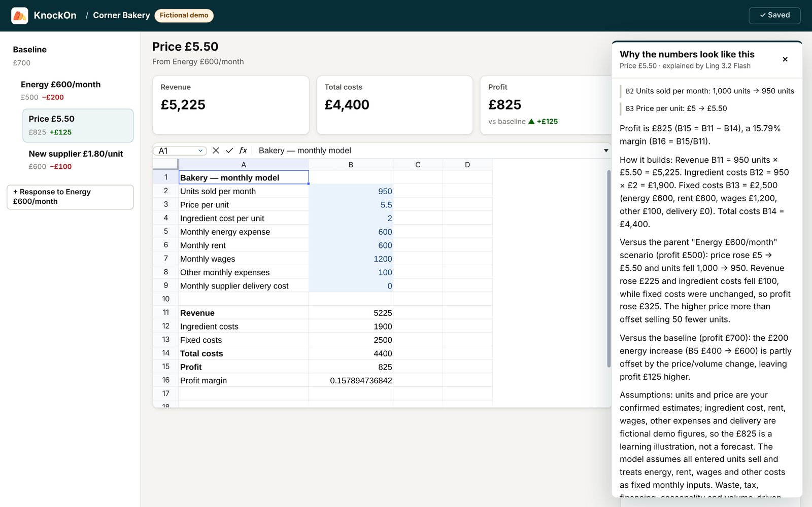
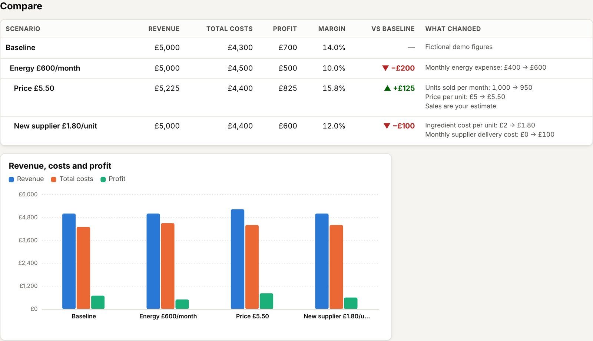
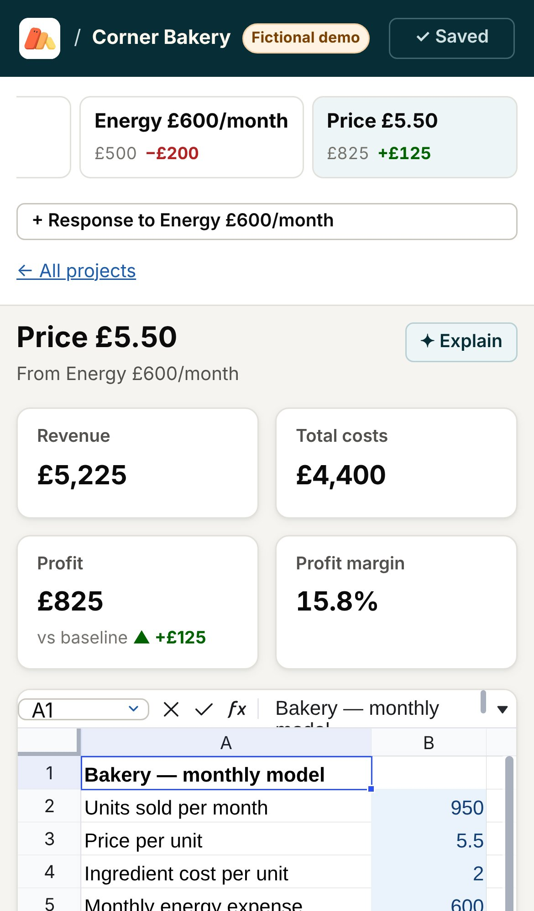
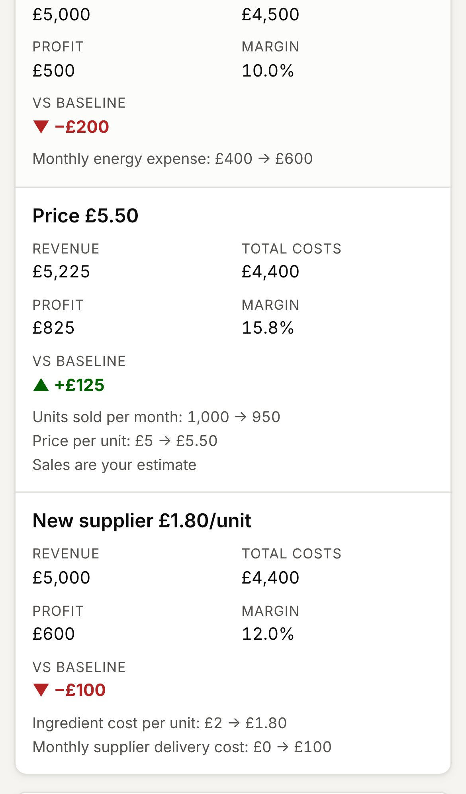
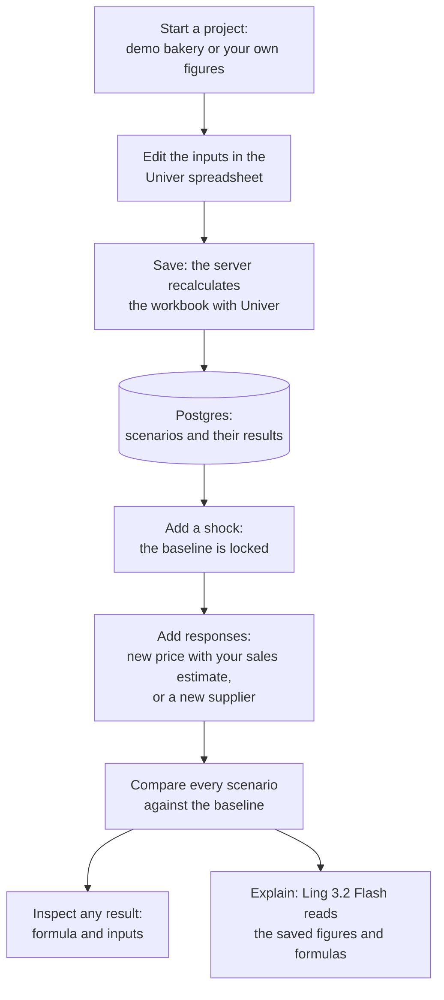

<p align="center">
  <a href="https://www.knockon.tech"></a>
  
  
  
  
</p>

# KnockOn

**See what one change sets in motion.**

KnockOn is an interactive economics lab for small business owners and economics learners. It turns a business into a real, editable Univer spreadsheet:
- Introduce a change, such as higher energy costs, a supplier price rise or falling sales, while the original baseline stays frozen.
- Try different responses as separate scenarios and compare them side by side.
- Click any result to see its formula and the inputs behind it.
- Ant Ling explains why the numbers look the way they do, but it never supplies a number.

The name comes from a knock-on effect: one change causes consequences elsewhere.

**Live:** https://www.knockon.tech (the app is at `/projects`, the documentation at `/docs`). No account is needed: your projects are private to your browser. Demo figures are fictional and for learning.

## See it

<p align="center"><a href="https://www.knockon.tech"></a></p>
<p align="center"><sub>The landing page, with Knocky, the halftone domino mascot.</sub></p>

<p align="center"></p>
<p align="center"><sub>The workspace. The model is a real Univer spreadsheet. Click any result to see its formula and every input behind it.</sub></p>

<table>
  <tr>
    <td width="50%"></td>
    <td width="50%"></td>
  </tr>
  <tr>
    <td><b>Add a shock.</b> Say what changed and by how much. The first shock locks the baseline, so every comparison starts from the same figures.</td>
    <td><b>Ask why.</b> Ling 3.2 Flash explains the saved figures, naming the cells, the inputs that changed and the assumptions behind them. It explains; it doesn't recalculate or recommend.</td>
  </tr>
</table>

<p align="center"></p>
<p align="center"><sub>Every scenario in one table and one chart: profit against the baseline, and what changed in each one.</sub></p>

<table>
  <tr>
    <td width="50%"></td>
    <td width="50%"></td>
  </tr>
  <tr>
    <td colspan="2" align="center"><b>Built for phones too.</b> On a narrow screen the comparison becomes one card per scenario.</td>
  </tr>
</table>

<sub>The screenshots come from a local build on 9 November 2026. The explanation is Ling 3.2 Flash's own reply to the scenario shown.</sub>

## Try it in two minutes

1. Open https://www.knockon.tech and tap **Open app**.
2. Name a project, pick a currency, choose **Fictional demo bakery** and tap **Create project**. The spreadsheet opens with revenue £5,000 and profit £700.
3. Edit a blue input cell in the sheet or in the input list, for example the price. The results update as Univer recalculates. Tap **Save**.
4. Tap **+ Add a shock** → **Energy or fuel costs rise** → `600`. The baseline locks, and profit drops by £200.
5. Tap **+ Response to Energy £600/month**:
   - **Change the price** to £5.50 and enter the sales you expect at that price, for example 950. KnockOn never guesses how customers react.
   - Or **Switch supplier** with a new ingredient cost and delivery cost.
6. Scroll to **Compare** to see every scenario against the baseline.
7. Tap any result to inspect its formula, or **✦ Explain** to ask Ling why the numbers look the way they do.
8. Above the worksheet, **Add overhead chart** to plot monthly energy, rent, wages, other expenses and delivery. Save it with the scenario. **Print / PDF** opens worksheet print preview; **Export Excel** downloads the saved scenario with its formulas and charts.

The same guide, with the model's inputs and formulas, is built into the app at [knockon.tech/docs](https://www.knockon.tech/docs).

## How it works



- **Calculation** (`src/lib/univer/`): Univer is the only calculation engine. The browser editor recalculates as you type. On every save and fork, the server recalculates the same workbook headlessly, and only those results are stored. Labels and formula cells are locked; only the eight inputs (B2:B9) can change.
- **Scenarios** (`src/server/projects.ts`, `src/lib/scenarios.ts`):
  - A project starts with one editable baseline.
  - A shock is a copy of the baseline with one change. The first shock freezes the baseline, so every comparison keeps the same starting point.
  - A response is a copy of a shock. A price change must come with your own sales estimate, which is recorded as a confirmed assumption.
- **Storage** (`src/server/db.ts`, `src/server/repository.ts`):
  - Postgres stores workbooks, assumptions and results as JSONB: Neon on Vercel, embedded PGlite for local runs and tests.
  - The schema migrates itself on first use.
  - Every save checks the project revision inside a transaction, so two edits can never silently overwrite each other. If a project changed in another tab, KnockOn keeps your draft and lets you apply it to the latest version.
- **Privacy** (`src/server/visitor.ts`): each browser gets a random private ID in an HttpOnly cookie, and projects are stored with a hash of it. Visitors only ever see their own projects; anyone else gets "not found".
- **API** (`src/app/api/`):

  | Route | Does |
  |---|---|
  | `GET /api/projects` | List your projects |
  | `POST /api/projects` | Create a project |
  | `GET /api/projects/:id` | Open a project with its scenarios |
  | `POST /api/projects/:id/scenarios` | Add a shock or response |
  | `PUT /api/projects/:id/scenarios/:sid` | Save a scenario |
  | `POST /api/projects/:id/scenarios/:sid/explanation` | Ask Ling to explain a saved scenario |
  | `POST /api/projects/:id/scenarios/:sid/export` | Download a saved scenario as `.xlsx`, with an expected revision |

## Univer

All Univer packages are pinned to the same release, 1.4.0.

| Use | Packages |
|---|---|
| Editable workbook in the browser, formula bar, cell editor | `@univerjs/sheets`, `@univerjs/sheets-ui`, `@univerjs/sheets-formula`, `@univerjs/sheets-formula-ui` |
| Headless recalculation on the server | `@univerjs/core`, `@univerjs/engine-formula`, `@univerjs/sheets`, `@univerjs/sheets-formula` |
| License | `@univerjs-pro/license`, registered only when `UNIVER_LICENSE` is set |
| Worksheet charts, saved and copied with each scenario | `@univerjs-pro/engine-chart`, `@univerjs-pro/chart-ui`, `@univerjs-pro/sheets-chart`, `@univerjs-pro/sheets-chart-ui` and the drawing plugins |
| Worksheet printing and browser Save as PDF | `@univerjs-pro/sheets-print` |
| Excel download with formulas and chart resources | `@univerjs-pro/exchange-node` (server only, with its native binding) |

The server reads `UNIVER_LICENSE` (the contents of `license.txt`) and passes only that to the browser editor. `UNIVER_LICENSE_KEY` and the AntLing key are never sent to the browser.

Excel export requires both license values on the server. Missing, expired or rejected licenses produce an unavailable message without affecting editing or saving. Vercel export requires an unlimited export subscription; metered licenses require a server with persistent local storage for Univer's usage ledger. See [SETUP.md](SETUP.md) for deployment details. The existing comparison charts remain application-rendered; the new worksheet chart uses Univer Pro and updates directly from its source cells.

## Ant Ling

Ling 3.2 Flash (`Ling-3.2-flash` through Ant Ling's OpenAI-compatible API) runs on the server for one job: explaining a saved scenario. It never supplies a number.

- **What it receives:**
  - the project and scenario names
  - the eight inputs with their cells
  - every formula with its calculated result
  - the inputs that changed from the parent scenario
  - profit against the baseline
  - the recorded assumptions, and what the model leaves out

  Everything comes from the saved, server-calculated revision.
- **What it is told:**
  - use only those figures
  - name the cells behind each point
  - say which figures are fictional or unconfirmed
  - say when something isn't modelled
  - never invent customer behaviour or recommend a decision
- **Safeguards:**
  - An explanation is tied to the revision it describes. After a later save, it is marked out of date.
  - A reply cut off at the length limit is rejected rather than shown.
  - The API key never reaches the browser.
  - If Ling is unavailable, the spreadsheet and every result keep working.
- **Limits:** 10 explanations per visitor per hour, 30 per network per hour and 300 for the whole site per day, counted in the database. A refused request is not counted.

## Run locally

Requires Node 22.13 or later.

```bash
npm install
npm test           # unit and integration tests
npm run typecheck
npm run build
npm run dev        # http://localhost:3000, the app is at /projects
```

Without a database URL, data is stored in an embedded Postgres in `./data/pglite` (ignored by Git).

| Variable | Where | Purpose |
|---|---|---|
| `DATABASE_URL` | server | Postgres connection string. Required on Vercel; the Neon integration sets it. |
| `UNIVER_LICENSE` | server, passed to the editor | Contents of Univer `license.txt`. |
| `ANTLING_API_KEY` | server | Turns on Explain. |
| `ANTLING_BASE_URL`, `ANTLING_MODEL` | server, optional | Defaults: `https://api.ant-ling.com/v1`, `Ling-3.2-flash`. |
| `EXPLAIN_LIMIT_PER_VISITOR_PER_HOUR`, `EXPLAIN_LIMIT_PER_NETWORK_PER_HOUR`, `EXPLAIN_LIMIT_SITE_PER_DAY` | server, optional | Explain limits. Defaults: 10, 30, 300. |
| `KNOCKON_DATABASE_PATH` | server, optional | Folder for the embedded database. |
| `SITE_URL` | server, optional | Base URL for link previews. Default: `https://www.knockon.tech`. |

`.env.example` lists them. Never commit real values. Deployment steps for Vercel are in [SETUP.md](SETUP.md).

| Check | Command |
|---|---|
| Calculations, storage, scenarios, privacy, limits and explanations | `npm test` |
| The HTTP API against a running server | `npm run smoke:api` |
| The whole interface in a real browser, including a phone layout | `npm run e2e` |
| Licensed charts, print preview, Excel download and export access checks | `npm run e2e:pro` |

## Limits

These are the honest gaps today:

- **One template:** the bakery model. Freelancer and household templates are not built yet.
- **Shocks and responses** are the ones listed above; there is no custom scenario type.
- **No accounts:** projects belong to one browser. Clearing cookies or switching devices starts an empty list.
- **No deleting** projects or scenarios. Excel export covers one scenario at a time; there is no full-project backup or import.
- **The sheet** shows the profit margin as a decimal (0.14); the metric cards and comparison show it as a percentage.
- **Not yet done:** backup and restore of the hosted database, and an external security review.

## Repository guide

- `src/app/`: pages (`/` landing, `/projects`, `/projects/[projectId]`, `/docs`) and API routes.
- `src/components/landing/`: the landing page and Knocky.
- `src/components/workspace/`: the workspace: spreadsheet, scenarios, comparison, inspect and Explain panels.
- `src/lib/univer/`: the browser editor adapter and the server recalculation.
- `src/lib/templates/bakery.ts`: the bakery model's cells, formulas and inputs.
- `src/server/`: storage, scenarios, explanations, privacy and rate limits.
- `tests/`: tests, run with Node's test runner. `scripts/`: the API smoke test and the browser test.
- `docs/`: the [build brief](docs/BUILD_BRIEF.md), the [model and API contract](docs/API_CONTRACT.md), the [build prompts](docs/BUILD_PROMPTS.md) and the README images.

## References

- Univer documentation: https://docs.univer.ai/
- Univer licensing: https://docs.univer.ai/guides/server-integration/license
- Ant Ling open platform: https://chat.ant-ling.com/open
